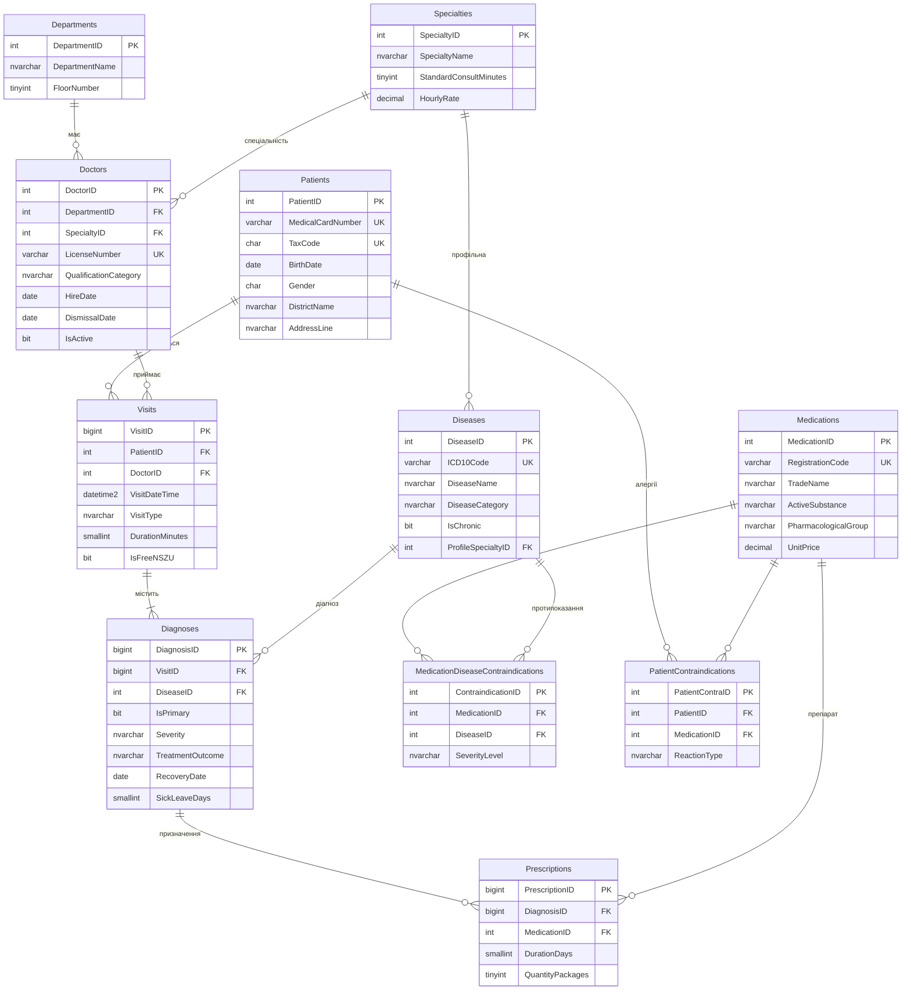
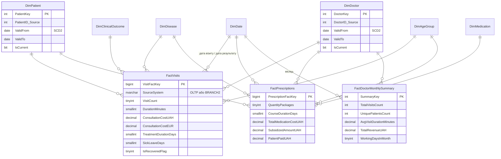

# Database — OLTP `PolyclinicOLTP` і сховище `PolyclinicDW`

Етап 1 (проєктування БД) і SQL-частина етапу 3 (сховище даних, процедури ETL, перевірка).

| Файл | Призначення |
|---|---|
| `CREATE_DATABASE.sql` | Створення бази `PolyclinicOLTP` (параметри для великих обсягів) |
| `CREATE_TABLES.sql` | 11 таблиць у 3НФ з первинними ключами |
| `CREATE_CONSTRAINTS.sql` | 18 DEFAULT, 11 UNIQUE (у т. ч. фільтровані індекси), 23 CHECK, 13 FOREIGN KEY, 10 некластерних індексів |
| `CREATE_TRIGGERS.sql` | 7 тригерів: складні бізнес-правила й автоматичний `UpdatedAt` |
| `CREATE_PROCEDURES.sql` | 3 функції та 5 збережених процедур |
| `CREATE_DW.sql` | Сховище `PolyclinicDW`: схема «зірка», staging (`stg`), аудит ETL (`etl`) |
| `RUN_ETL_PIPELINE.sql` | Процедури `etl.*`: журнал запусків, watermarks, SCD1/SCD2, MERGE-завантаження фактів; T-SQL-еталон ETL |
| `VERIFY_DW.sql` | Смоук-тест сховища й ETL (42 перевірки PASS/FAIL) |

Порядок запуску: `CREATE_DATABASE` → `CREATE_TABLES` → `CREATE_CONSTRAINTS` → `CREATE_TRIGGERS` → `CREATE_PROCEDURES` → (дані: [DataGeneration](../DataGeneration/)) → `CREATE_DW` → `RUN_ETL_PIPELINE` → завантаження через SSIS → `VERIFY_DW`.

---

## 1. Аналіз предметної області

Поліклініка обслуговує прикріплених пацієнтів: лікар проводить прийом (візит), ставить один або кілька діагнозів за МКХ-10 і за потреби виписує рецепти. Препарат може бути протипоказаний при певній хворобі або пацієнту особисто (алергія), тому кожне призначення перевіряється.

**Основні бізнес-процеси:** реєстрація візиту й первинного діагнозу; призначення ліків з перевіркою протипоказань; закриття випадку (результат лікування, дата одужання, лікарняний); облік завантаженості лікарів; аналіз ефективності лікування та захворюваності.

**Бізнес-правила (реалізовані обмеженнями й тригерами):**

| Правило | Реалізація |
|---|---|
| Рецепт не можна виписати при алергії пацієнта або абсолютному протипоказанні до будь-якої активної/хронічної хвороби | `TR_Prescriptions_CheckContraindications` (помилки 50001, 50002) |
| Дата візиту не раніша за дату народження пацієнта й дату прийому лікаря на роботу; до звільненого лікаря запис неможливий | `TR_Visits_ValidateBusinessRules` (50003–50005) |
| Дата діагнозу не раніша за дату візиту | `TR_Diagnoses_ValidateBusinessRules` (50006) |
| Один основний діагноз на візит; хвороба один раз у межах візиту | `UX_Diagnoses_OnePrimaryPerVisit` (фільтрований), `UQ_Diagnoses_Visit_Disease` |
| Дата одужання відсутня тоді й лише тоді, коли лікування «В процесі» | `CK_Diagnoses_OutcomeRecovery` |
| Активний лікар не має дати звільнення, звільнений — має | `CK_Doctors_ActiveStatus`, `CK_Doctors_DismissalDate` |
| Вартість прийому не зберігається (3НФ), а обчислюється: тривалість × погодинна ставка спеціальності; безкоштовні прийоми НСЗУ = 0 | `ufn_CalculateVisitCost` |

## 2. ER-діаграма (логічна модель OLTP)

**Кардинальності:** відділення 1 : N лікарі; пацієнт 1 : N візити; візит 1 : N діагнози (≥ 1, рівно один основний); діагноз 1 : N рецепти; зв'язки M : N «препарат ↔ хвороба» і «пацієнт ↔ препарат» розв'язано асоціативними таблицями протипоказань.

## 3. Логічне та фізичне проєктування

- **Нормалізація до 3НФ:** довідники відділень, спеціальностей, хвороб і препаратів винесено окремо; вартість прийому не зберігається, бо залежить від тривалості й ставки спеціальності (транзитивна залежність). Денормалізація свідомо застосована лише у сховищі (виміри лікаря й хвороби).
- **Індекси під запити звітів:** `IX_Visits_VisitDateTime_Doctor`, `IX_Visits_PatientID_Date`, `IX_Visits_DoctorID_Patient`, `IX_Diagnoses_DiseaseID_Outcome`, `IX_Diagnoses_VisitID`, `IX_Prescriptions_DiagnosisID`, `IX_Prescriptions_MedicationID`, `IX_PatientContra_MedicationID`, `IX_Patients_LastName_FirstName`, `IX_Doctors_Department_Specialty` + унікальні фільтровані `UQ_Patients_TaxCode`, `UX_Diagnoses_OnePrimaryPerVisit`. Вплив індексів вимірюється в `DataGeneration/VERIFY_DATA.sql` (розділ 5).
- **Функції:** `ufn_GetPatientAge`, `ufn_CalculateVisitCost` (скалярні), `ufn_GetPatientContraindicatedMedications` (таблична).
- **Процедури:** `usp_RegisterVisitAndDiagnosis`, `usp_PrescribeMedication`, `usp_CloseDiagnosisCase` (транзакції; закриття випадку перевіряє коди 50010–50013), `usp_GetDoctorMonthlyWorkload`, `usp_GetPatientMedicalHistory`.

## 4. Сховище даних `PolyclinicDW` (зірка)

| Таблиця | Тип | Зміст |
|---|---|---|
| `DimDate` | вимір часу | Рік → Квартал → Місяць → День, день тижня, номер тижня, свята України |
| `DimPatient` | SCD Type 2 (район, адреса) + Type 1 | пацієнти |
| `DimDoctor` | SCD Type 2 (відділення, спеціальність, категорія, ставка) + Type 1 | лікарі, денормалізовано з відділень і спеціальностей |
| `DimDisease` | SCD Type 1 | хвороби МКХ-10 (розділ → категорія → хвороба) |
| `DimMedication` | SCD Type 1 | фармгрупа → діюча речовина → препарат |
| `DimAgeGroup` | статичний | вікова група на дату візиту |
| `DimClinicalOutcome` | junk-вимір | тип візиту × тяжкість × результат лікування |
| `FactVisits` | факт (зерно — діагноз у візиті) | джерела OLTP + архів Філії №2 |
| `FactPrescriptions` | факт | рецепти |
| `FactDoctorMonthlySummary` | агрегований факт | завантаженість лікаря за місяць (трансформація Aggregate) |
| `RefExchangeRate` | довідник | курс EUR/UAH для конвертації валют |

Кожен вимір має «невідомий» член з ключем `-1` (`DimDate`: `19000101`). Факти мають некластерні columnstore-індекси.

**Схема `etl` (аудит і контроль якості):** `PackageExecutionLog` (журнал запусків), `TaskLog` (кількість прочитаних / вставлених / оновлених / відхилених рядків), `Watermarks` (інкрементальне завантаження), `ErrorRecords` (карантин помилкових записів), реєстр оброблених файлів архіву.
