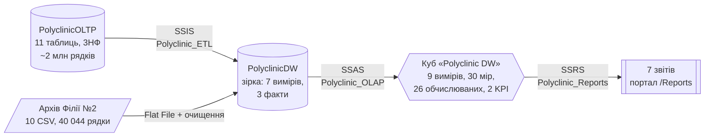

# Курсова робота NVBD — Варіант 6 «Поліклініка»

**Дисципліна:** Надвеликі бази даних
**Тема:** Розробка та аналіз надвеликої бази даних з використанням технологій Microsoft SQL Server
**Предметна область:** поліклініка — пацієнти, лікарі, діагнози, хвороби (МКХ-10), лікарські засоби, протипоказання
**Студент:** `<ПІБ>`, група `<група>`

| Матеріал | Посилання |
|---|---|
| Пояснювальна записка (PDF) | [`Documentation/`](Documentation/) — `Звіт_<ПІБ>.pdf` |
| Відеопрезентація (YouTube) | `<посилання на відео>` |

---

## Що реалізовано

Повний ланцюжок Microsoft BI: транзакційна база → генерація даних → ETL у сховище → OLAP-куб → аналітичні звіти.



| Етап (бали) | Результат | Деталі |
|---|---|---|
| 1. Проєктування БД (15) | OLTP `PolyclinicOLTP`: 11 таблиць у 3НФ, PK/FK/CHECK/UNIQUE/DEFAULT, 12 індексів, 7 тригерів, 3 функції, 5 процедур | [Database/](Database/) |
| 2. Генерація даних (10) | 60 000 пацієнтів, 551 883 візити, 574 952 діагнози (історії хвороб), 607 834 рецепти, 100 000 препаратів; 2016–2025 (10 років); резервна копія, верифікація 42/42 PASS | [DataGeneration/](DataGeneration/) |
| 3. ETL, SSIS (25) | Сховище `PolyclinicDW` (зірка, SCD1 + SCD2), 6 пакетів, 9 типів трансформацій, інкрементальне завантаження, checkpoint-відновлення, аудит | [SSIS_Projects/](SSIS_Projects/) |
| 4. OLAP-куб, SSAS (25) | 9 вимірів (Time, SCD2, сніжинка), 5 груп мір / 30 мір, 26 обчислюваних мір, 4 набори, 2 KPI, 3 перспективи, партиції MOLAP/HOLAP/ROLAP, агрегації ≈30 % | [SSAS_Projects/](SSAS_Projects/) |
| 5. Звіти, SSRS (25) | 5 обов'язкових звітів варіанту + реєстр пацієнтів + підзвіт; Table, Matrix, Chart, Dashboard, Drill-down/Drillthrough; 5 типів параметрів | [SSRS_Projects/](SSRS_Projects/) |

### Обов'язкові звіти варіанту

| № | Звіт варіанту 6 | Файл | Тип |
|---|---|---|---|
| 1 | Список лікарів та їх пацієнтів | `Лікарі та їх пацієнти.rdl` | Таблиця з групами, drill-down, drillthrough |
| 2 | Історія хвороби пацієнта | `Історія хвороби пацієнта.rdl` (+ `Рецепти діагнозу.rdl`, `Реєстр пацієнтів.rdl`) | Документ із підзвітом |
| 3 | Завантаженість лікарів по місяцях | `Завантаженість лікарів по місяцях.rdl` | Матриця + Column/Line |
| 4 | Аналіз ефективності лікування | `Аналіз ефективності лікування.rdl` | Дашборд: KPI, gauge, індикатори, sparkline |
| 5 | Статистика захворювань | `Статистика захворювань.rdl` | Column, Pie, Line, Bar |

---

## Структура репозиторію

```
Kursova_NVBD_Variant_06/
├── README.md                     ← цей файл
├── Documentation/                ← пояснювальна записка (PDF) і скріншоти
├── Database/                     ← OLTP (CREATE_*.sql) і сховище DW (CREATE_DW, RUN_ETL_PIPELINE, VERIFY_DW)
├── DataGeneration/               ← генерація, верифікація, бекап; архів Філії №2 (CSV)
├── SSIS_Projects/                ← проєкт Polyclinic_ETL (.dtsx) + скрипти запуску й тестів
├── SSAS_Projects/                ← проєкт Polyclinic_OLAP (куб, виміри) + MDX, перевірка, бекап
├── SSRS_Projects/                ← проєкт Polyclinic_Reports (.rdl, .rsd, .rds)
└── tools/                        ← deploy.ps1 — розгортання бази одним запуском
```

---

## Середовище

| Компонент | Версія / налаштування |
|---|---|
| SQL Server | 2025 Enterprise Developer (17.0), екземпляр `MSSQLSERVER`, collation `Ukrainian_CI_AS` |
| Integration Services | каталог `SSISDB` → папка `Polyclinic` → проєкт `Polyclinic_ETL` |
| Analysis Services | Multidimensional, база `Polyclinic_OLAP`, куб `Polyclinic DW` |
| Reporting Services | 2022, портал `http://<сервер>/Reports`, папка `Поліклініка` |
| Інструменти | Visual Studio 2026 + розширення SSIS / SSAS / Reporting Services, SSMS 22 |

Ім'я сервера в проєктах — `DESKTOP-I5COGTD`. На іншому комп'ютері його треба замінити в `*.conmgr` (SSIS), `Polyclinic DW.ds` (SSAS) і `PolyclinicOLAP.rds` (SSRS).

---

## Порядок розгортання

1. **OLTP + дані.** SSMS: по черзі виконати `Database/CREATE_DATABASE.sql` → `CREATE_TABLES.sql` → `CREATE_CONSTRAINTS.sql` → `CREATE_TRIGGERS.sql` → `CREATE_PROCEDURES.sql` → `DataGeneration/GENERATE_DATA.sql` (≈1–2 хв) → `VERIFY_DATA.sql` → `BACKUP_DATABASE.sql`.
   Або одним запуском: `powershell -ExecutionPolicy Bypass -File .\tools\deploy.ps1 [-SqlUser sa -SqlPassword <пароль>]`.
2. **Сховище.** `Database/CREATE_DW.sql` → `Database/RUN_ETL_PIPELINE.sql` (процедури `etl.*`).
3. **SSIS.** Відкрити `SSIS_Projects/Polyclinic_ETL/Polyclinic_ETL.slnx` → Deploy у `SSISDB\Polyclinic` → `SSIS_Projects/RUN_SSIS_CATALOG.sql` (`@LoadType = 'Full'`) → `Database/VERIFY_DW.sql`.
4. **SSAS.** `SSAS_Projects/SETUP_SSAS_PERMISSIONS.sql` → відкрити `Polyclinic_OLAP.slnx` → Deploy + Process Full → `SSAS_Projects/VERIFY_CUBE.sql`.
5. **SSRS.** Відкрити `SSRS_Projects/Polyclinic_Reports/Polyclinic_Reports.slnx` → Deploy на `http://<сервер>/ReportServer` → портал `/Reports` → `Поліклініка/Звіти`.

Деталі кожного кроку — у README відповідної папки.

---

## Тестування та перевірки

| Що перевіряється | Скрипт | Результат |
|---|---|---|
| Обсяги, реалістичність, обмеження цілісності, тригери, вплив індексів | `DataGeneration/VERIFY_DATA.sql` | 42/42 PASS |
| Коректність ETL: звірка OLTP ↔ DW, SCD2, інкрементальний сценарій | `Database/VERIFY_DW.sql` | 42/42 PASS |
| Інкрементальне завантаження SSIS (watermarks, SCD2, UPSERT) | `SSIS_Projects/TEST_SSIS_INCREMENTAL.sql` | 12/12 PASS |
| Відновлення після збою (checkpoint) | `SSIS_Projects/TEST_SSIS_CHECKPOINT.sql` | 12/12 PASS |
| Куб: структура, звірка зі сховищем, MDX-обчислення, продуктивність | `SSAS_Projects/VERIFY_CUBE.sql` | 35/35 PASS |
| Звіти: параметри, каскади, валідація дат, переходи, експорт | смоук-тест у Preview / на порталі | див. [SSRS_Projects/](SSRS_Projects/#тестування) |

**Продуктивність куба** (типовий аналітичний запит): холодний кеш 204 мс, теплий кеш 36 мс; той самий запит без агрегацій — 1 763 мс.

---

## Скріншоти

> Зображення лежать у `Documentation/screenshots/` (перелік — у [Documentation/README.md](Documentation/README.md)).

| | |
|---|---|
|  |  |
|  |  |
|  |  |
|  |  |
