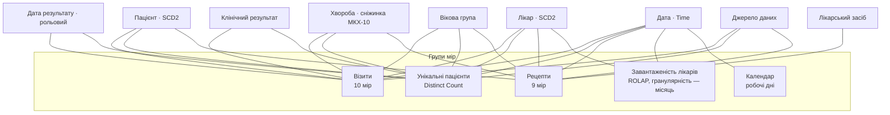

# SSAS_Projects — OLAP-куб `Polyclinic DW`

Етап 4: багатовимірна модель SQL Server Analysis Services (Multidimensional) над сховищем `PolyclinicDW`.

| Файл / папка | Призначення |
|---|---|
| `Polyclinic_OLAP/Polyclinic_OLAP.slnx` | Рішення Visual Studio (проєкт у підпапці `Polyclinic_OLAP/`) |
| `Polyclinic_OLAP/Polyclinic_OLAP/Polyclinic DW.ds` | Джерело даних (`PolyclinicDW`, режим ImpersonateServiceAccount) |
| `Polyclinic_OLAP/Polyclinic_OLAP/Polyclinic DW.dsv` | Data Source View: 10 таблиць, 12 Named Calculations, 3 Named Queries |
| `Polyclinic_OLAP/Polyclinic_OLAP/Dim *.dim` | 8 вимірів бази |
| `Polyclinic_OLAP/Polyclinic_OLAP/Polyclinic DW.cube` | Куб: групи мір, MDX-скрипт, KPI, перспективи |
| `Polyclinic_OLAP/Polyclinic_OLAP/Polyclinic DW.partitions` | Партиції та дизайни агрегацій |
| `SETUP_SSAS_PERMISSIONS.sql` | Доступ служби SSAS (`NT Service\MSSQLServerOLAPService`) до сховища — виконати один раз |
| `MDX_Queries.mdx` | 10 демонстраційних MDX-запитів |
| `VERIFY_CUBE.sql` | Перевірка куба через linked server: структура, звірка зі сховищем, MDX, продуктивність (35 перевірок PASS/FAIL) |
| `BACKUP_CUBE.xmla` | Резервна копія бази `Polyclinic_OLAP` → `Polyclinic_OLAP.abf` |

## Розгортання

1. SSMS (Database Engine) → `SETUP_SSAS_PERMISSIONS.sql`.
2. Visual Studio → `Polyclinic_OLAP.slnx` → **Deploy** на сервер Analysis Services (база `Polyclinic_OLAP`) → **Process Full**.
3. SSMS → `VERIFY_CUBE.sql` (35/35 PASS); SSMS → Analysis Services → New MDX Query → `MDX_Queries.mdx`.
4. Резервна копія: SSMS → Analysis Services → `BACKUP_CUBE.xmla` → Execute.

## Архітектура куба

### Виміри

| Вимір | Ієрархії | Особливості |
|---|---|---|
| **Дата** (Type = Time) | Календар: Рік → Квартал → Місяць → День | атрибути день тижня, номер тижня, свято / робочий день; рольовий вимір **Дата результату** |
| **Пацієнт** | Географія: Район → Пацієнт; Демографія: Стать → Пацієнт | SCD Type 2 (атрибут «Версія пацієнта», властивості адреса / діє з / діє до); обчислюваний член «Пенсійного віку (народжені до 1962 року)» |
| **Лікар** | Структура поліклініки: Відділення → Спеціальність → Лікар | SCD Type 2, властивості ставка, категорія |
| **Хвороба** | МКХ-10: Розділ → Хвороба; Категорії: Категорія → Хвороба | сніжинка (розділи МКХ-10 окремою таблицею DSV) |
| **Лікарський засіб** | Фармакологія: Фармгрупа → Діюча речовина → Препарат; Виробники: Країна → Виробник → Препарат | |
| **Вікова група** | — | обчислюваний член «Дорослі від 18 років» |
| **Клінічний результат** | Результати лікування: Група результату → Результат | junk-вимір: тип візиту, тяжкість, результат |
| **Джерело даних** | — | OLTP / архів Філії №2 |

Для всіх вимірів задано ключові атрибути (Key Attributes), атрибутні зв'язки (Attribute Relationships), `NameColumn` / `OrderBy`; `KeyDuplicate = ReportAndStop`.

### Міри (30) і групи мір (5)

| Тип агрегації | Міри |
|---|---|
| **Sum** | Кількість візитів, Тривалість прийомів у хв, Вартість консультацій у грн / EUR, Дні лікарняних, Дні лікування, Випадків з одужанням, Завершених випадків, Безкоштовних візитів НСЗУ, Кількість рецептів, Упаковок, Днів курсу лікування, Вартість ліків у грн, Компенсація держави у грн, Доплата пацієнтів у грн, Пільгових рецептів, Візитів за місяць, Дохід за місяць у грн, Робочих днів … |
| **Count** | Кількість діагнозів, Лікаре-місяців, Календарних днів |
| **Min / Max** | Мінімальна / Максимальна ціна упаковки у грн, Мінімальна / Максимальна тривалість прийому у хв |
| **Distinct Count** | Унікальних пацієнтів (окрема група мір) |
| **Average** | реалізовано обчислюваними мірами (Sum / Count) — коректно на будь-якому рівні: Середня тривалість прийому у хв, Середня вартість платного прийому у грн, Середня тривалість лікування у днях |

### MDX-обчислення (26 обчислюваних мір, 4 набори, 2 обчислювані члени, 2 KPI)

| Категорія | Обчислення |
|---|---|
| **Time Intelligence** | Візити з початку року (YTD), Візити попереднього року (PY), Приріст візитів YoY; Вартість консультацій YTD / PY / YoY; Частка одужань PY |
| **Ranking** | Рейтинг лікаря за візитами, Рейтинг хвороби; набори «Топ-10 лікарів за візитами», «Топ-10 хвороб за кількістю випадків», «Топ-10 препаратів за вартістю», «Лікарі за кількістю візитів» |
| **Moving Averages** | Ковзне середнє візитів (3 періоди) |
| **Відсоткові показники** | Частка одужань, Частка безкоштовних візитів НСЗУ, Частка хвороби у візитах, Частка лікаря у візитах, Частка компенсації ліків |
| **Бізнес-метрики** | Дохід на годину прийому у грн, Візитів на робочий день, Візитів на лікаря за місяць, Вартість ліків на пацієнта у грн, Рецептів на діагноз, Лікарняних на діагноз у днях |
| **KPI** | **Ефективність лікування** — частка одужань, ціль 70 %, жовта зона 63–70 %, тренд до попереднього року; **Дохід від консультацій** — ціль: попередній рік × 1,05 |

## Налаштування та оптимізація

| Вимога | Реалізація |
|---|---|
| Агрегації (мін. 30 %) | Дизайни агрегацій для груп «Візити», «Рецепти», «Унікальні пацієнти» — 30–31 % |
| Storage Mode | MOLAP (2020–2026), **HOLAP** (архівні партиції 2016–2019), **ROLAP** (група «Завантаженість лікарів» — завжди актуальна) |
| Партиції | за роками: 2016–2019, 2020–2022, 2023–2025, 2026 для «Візитів», «Рецептів», «Унікальних пацієнтів» |
| Атрибутні зв'язки | ланцюжки ієрархій (День → Місяць → Квартал → Рік тощо) з `RelationshipType` |
| Perspectives | «Клінічна аналітика», «Фармація», «Завантаженість лікарів» |

## Тестування та продуктивність

`VERIFY_CUBE.sql` (через linked server `SSAS_POLYCLINIC`) — 35/35 PASS:
- **A.** структура куба (DMV): виміри, групи мір, KPI, перспективи, партиції;
- **B.** звірка базових мір куба зі сховищем (кількості, суми);
- **C.** SCD2, сніжинка, обчислювані члени;
- **D.** MDX-обчислення (YTD, PY, YoY, рейтинги, ковзне середнє, KPI);
- **E.** продуктивність: куб (холодний / теплий кеш) проти реляційного сховища.

| Запит | Час |
|---|---:|
| Куб, холодний кеш | 204 мс |
| Куб, теплий кеш | 36 мс |
| Той самий запит без агрегацій | 1 763 мс |
