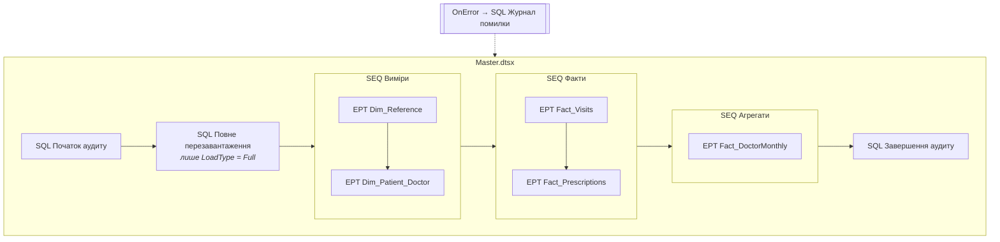
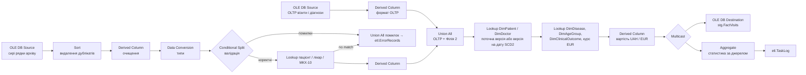

# SSIS_Projects — ETL `Polyclinic_ETL`

Етап 3: завантаження сховища `PolyclinicDW` з OLTP `PolyclinicOLTP` і CSV-архіву Філії №2 засобами SQL Server Integration Services.

| Файл / папка | Призначення |
|---|---|
| `Polyclinic_ETL/Polyclinic_ETL.slnx` | Рішення Visual Studio (проєкт у підпапці `Polyclinic_ETL/`) |
| `Polyclinic_ETL/Polyclinic_ETL/*.dtsx` | 6 пакетів (опис нижче) |
| `Polyclinic_ETL/Polyclinic_ETL/Project.params` | Параметри проєкту: `LoadType`, `ArchiveFolder`, `CheckpointFolder`, `SimulateFailureAt` |
| `Polyclinic_ETL/Polyclinic_ETL/*.conmgr` | Підключення до `PolyclinicOLTP` і `PolyclinicDW` (OLE DB) |
| `RUN_SSIS_CATALOG.sql` | Запуск `Master.dtsx` з каталогу `SSISDB` і перегляд журналів |
| `TEST_SSIS_INCREMENTAL.sql` | Тест інкрементального завантаження (12 перевірок PASS/FAIL) |
| `TEST_SSIS_CHECKPOINT.sql` | Тест відновлення після збою (12 перевірок PASS/FAIL) |

## Запуск

1. Створити сховище: `../Database/CREATE_DW.sql`, `../Database/RUN_ETL_PIPELINE.sql`.
2. Відкрити `Polyclinic_ETL.slnx` у Visual Studio → **Deploy** у каталог `SSISDB\Polyclinic`.
3. SSMS → `RUN_SSIS_CATALOG.sql` з `@LoadType = 'Full'` (повне завантаження ≈2,5 хв) або `'Incremental'`.
4. Перевірка: `../Database/VERIFY_DW.sql` (42/42 PASS), далі `TEST_SSIS_INCREMENTAL.sql`, `TEST_SSIS_CHECKPOINT.sql`.

## Архітектура пакетів

| Пакет | Що робить |
|---|---|
| `Master.dtsx` | Оркестрація: аудит запуску, повне перезавантаження (параметр `LoadType`), послідовний виклик дочірніх пакетів у Sequence Container; checkpoint-файл для рестарту з місця збою |
| `Dim_Reference.dtsx` | `DimDisease`, `DimMedication` — SCD Type 1: нові рядки вставляються, змінені через staging застосовуються `MERGE` |
| `Dim_Patient_Doctor.dtsx` | `DimPatient`, `DimDoctor` — SCD Type 2 з інкрементальним витягуванням за watermark (`UpdatedAt`) |
| `Fact_Visits.dtsx` | Архів Філії №2 (ForEach Loop по CSV, Script Task, очищення, карантин) + візити й діагнози OLTP → `Union All` → пошук ключів вимірів (у т. ч. версії SCD2 на дату візиту) → `MERGE FactVisits` |
| `Fact_Prescriptions.dtsx` | Інкрементальне завантаження рецептів, пошук ключів, розрахунок компенсації / доплати → `MERGE FactPrescriptions` |
| `Fact_DoctorMonthly.dtsx` | Агрегування візитів до рівня «лікар × місяць» (Aggregate) → `FactDoctorMonthlySummary` |

## Data Flow `Fact_Visits` (основний пакет)

## Відповідність вимогам методички

| Вимога | Реалізація |
|---|---|
| DW: зірка, ≥ 2 факти, ≥ 5 вимірів, SCD | 3 факти, 7 вимірів; SCD1 (`DimDisease`, `DimMedication`), SCD2 (`DimPatient`, `DimDoctor`) — див. [Database/README.md](../Database/README.md#4-сховище-даних-polyclinicdw-зірка) |
| Extract: Data Flow, OLE DB Source, інкрементальне завантаження, обробка помилок | 8 Data Flow; OLE DB Source + Flat File Source; watermarks у `etl.Watermarks`, реєстр уже завантажених файлів архіву; error output Lookup / Conditional Split → `etl.ErrorRecords` |
| **Трансформації (мін. 5 типів)** — реалізовано **9** | **Data Cleansing** (Sort із видаленням дублікатів, Derived Column: TRIM / UPPER / нормалізація кодів, NULL → значення за замовчуванням, Conditional Split для некоректних значень); **Data Conversion** (UTF-8 → Unicode, текст → число / дата, формат дат `yyyy-MM-dd`, конвертація EUR → грн); **Derived Column** (вартість прийому, вікова група, бізнес-ключі); **Lookup** (11 у `Fact_Visits`: картка, ліцензія, МКХ-10, версії SCD2, курс валют); **Aggregate** (завантаженість лікаря за місяць, статистика за джерелом); **Conditional Split** (валідація, вибір версії SCD2, змінені атрибути SCD1); **Union All** (OLTP + архів, версії SCD2, помилкові записи); **Multicast**; **Row Count** |
| Load: OLE DB Destination, повне / інкрементальне, відновлення після збою | OLE DB Destination у staging → `MERGE` (UPSERT без дублікатів); параметр `LoadType` = `Full` / `Incremental`; checkpoint у `Master.dtsx` (`SaveCheckpoints`, задачі Execute Package з `FailPackageOnFailure`) |
| Execute SQL Task, Script Task, For Each Loop, Sequence Container, Event Handlers | 54 Execute SQL Task; Script Task «SCR Перевірка файлу» (C#); For Each Loop по файлах архіву; Sequence Container у кожному пакеті; `OnError` у всіх 6 пакетах |
| Контроль якості ETL: логування, кількість оброблених записів, помилкові записи, аудит | `etl.PackageExecutionLog`, `etl.TaskLog` (прочитано / вставлено / оновлено / відхилено), `etl.ErrorRecords`; журнали каталогу `SSISDB` |

## Результати

- Повне завантаження `Master.dtsx` ≈2,5 хв.
- Архів Філії №2: 40 044 рядки → 38 847 завантажено, 1 197 відхилено в карантин (дублікати, некоректні дати, неіснуючі картки / ліцензії / коди МКХ-10, тривалість поза діапазоном).
- `TEST_SSIS_INCREMENTAL.sql` 12/12 PASS: витягуються лише змінені рядки, нові версії SCD2, UPSERT без дублікатів, архів повторно не завантажується.
- `TEST_SSIS_CHECKPOINT.sql` 12/12 PASS: після імітованого збою `Fact_Prescriptions` повторний запуск пропускає вже виконані задачі й продовжує з точки збою.
